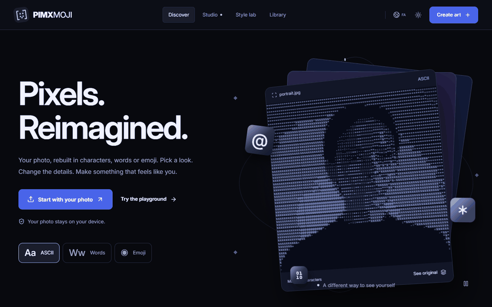

<div align="center">

<a href="https://pimxmoji.pages.dev/"></a>

[English](README.md) · [فارسی](README.fa.md) · [Live website ↗](https://pimxmoji.pages.dev/)

[](https://github.com/MOHAMMADREZAABEDINPOOR/PIMX_MOJI)

</div>

# PIMX MOJI

عکس‌ها را با ۳۰۰ سبک و پیش‌نمایش روی تصویر خودت به پرترهٔ ASCII، موزاییک کلمه یا هنر ایموجی تبدیل کن. با قلم‌مو ویرایش کن، حرکت اضافه کن و خروجی PNG، متن، GIF یا ویدئو بگیر؛ پروژه‌ها و پشتیبان قابل انتقال در مرورگرت می‌مانند.

<a href="https://pimxmoji.pages.dev/"></a>

[پیش‌نمایش رابط بازطراحی‌شده · PNG](assets/readme/redesign.png) · [Static artwork](assets/readme/hero.png)

## امکانات

- ۳۰۰ سبک با پیش‌نمایش روی عکس خودت با ماوس، کیبورد و لمس
- قلم‌مو، واگرد و بازانجام، سبک دلخواه و ۱۸ جلوهٔ حرکتی
- خروجی PNG، متن، GIF و ویدئو؛ کتابخانهٔ IndexedDB و پشتیبان و بازیابی قابل انتقال

## ساخت و خروجی گرفتن

از استودیو عکس بارگذاری کن، تصویر دوربین بگیر یا با ویدئو کار کن. نام هرکدام از ۳۰۰ سبک را با ماوس یا کیبورد پیش‌نمایش کن؛ روی موبایل دکمهٔ پیش‌نمایش کنار نام سبک قرار دارد. با انتخاب سبک و تنظیم جزئیات، Generate را بزن تا اثر نهایی در صفحهٔ نتیجه باز شود.

قلم‌مو، واگرد و بازانجام، سبک دلخواه، مقایسه، خروجی گروهی و ۱۸ جلوهٔ حرکتی در دسترس‌اند. صفحهٔ نتیجه امکان بزرگ‌نمایی، جابه‌جایی تصویر، نمایش بزرگ و انتخاب حرکت را دارد. تنظیم اندازه، حاشیه و امضا در پیش‌نمایش واقعی PNG اعمال می‌شود. GIF و ویدئو حرکت انتخاب‌شده و نسبت تصویر را حفظ می‌کنند. قالب‌های آواتار، استوری، والپیپر و پوستر و پس‌زمینهٔ شفاف برای PNG وجود دارند. پشتیبانی ویدئو به مرورگر وابسته است؛ دوربین فقط پس از اجازهٔ شما روی HTTPS یا localhost فعال می‌شود.

## کتابخانه و پشتیبان

عکس‌ها، پروژه‌های قابل ویرایش و سبک‌های شخصی در IndexedDB همین مرورگر می‌مانند. ویرایش‌ها پس از مکث کوتاه خودکار ذخیره می‌شوند. از صفحهٔ کتابخانه پشتیبان کامل با پسوند `.pimx-library.json` بگیر و روی دستگاه دیگر بازیابی کن. بازیابی داده‌ها را ادغام می‌کند؛ نسخهٔ جدیدتر هر پروژه حفظ می‌شود، سبک‌های قبلی باقی می‌مانند و ورود دوبارهٔ یک پشتیبان پروژهٔ تکراری نمی‌سازد. فایل نامعتبر پیش از نوشتن رد می‌شود و حداکثر حجم ورودی پشتیبان ۱۵۰ مگابایت است.

فایل پشتیبان شامل عکس‌هایت است. پاک‌کردن داده‌های سایت یا پایان نشست خصوصی ممکن است پروژه‌ها را حذف کند؛ نسخه‌ای از پشتیبان را بیرون مرورگر نگه دار.

## اجرا و انتشار

Node.js نسخهٔ 22.13 یا جدیدتر لازم است. برنامه برای پردازش و ذخیره‌سازی به بک‌اند، حساب، کلید API یا پایگاه دادهٔ ابری نیاز ندارد.

```sh
npm ci
npm run dev
```

```sh
npm run lint
npm run build
npm test
```

ساخت نهایی در `dist` قرار می‌گیرد و با `npm run preview` قابل بررسی است. مسیرهای `/`، `/studio`، `/styles`، `/library` و `/result` پیش‌رندر می‌شوند؛ کتابخانه و نتیجه `noindex` هستند. زبان در تنظیمات مرورگر ذخیره می‌شود و نشانی صفحه را عوض نمی‌کند. لینک‌های قدیمی زبان و hash همچنان باز می‌شوند. میزبان استاتیک باید index پوشه‌ها را ارائه کند و برای مسیرهای دیگر به `index.html` اصلی برگردد.

اگر دامنه عوض شد، `SITE` را در `src/studio/seo.ts`، نشانی‌های مطلق `index.html` و `public/robots.txt` تغییر بده. راهنمای کامل استودیو و پشتیبان در [STUDIO.md](STUDIO.md) است؛ اعتبار عکس نمونه و فونت‌ها در `public/samples` و `public/fonts` آمده است.

[GitHub](https://github.com/MOHAMMADREZAABEDINPOOR/PIMX_MOJI) · [PIMX](https://github.com/MOHAMMADREZAABEDINPOOR) · [Portfolio](https://pimx.pages.dev/)
