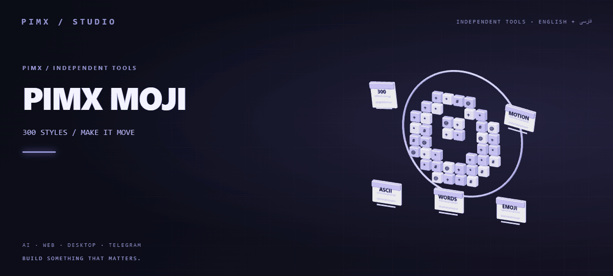

<div align="center">



[English](README.md) | [فارسی](README.fa.md) | [Live website](https://pimxmoji.pages.dev/)

</div>

# PIMX MOJI

A browser-based photo-to-character studio with 300 styles: ASCII, word mosaics and emoji art. Persian/English, dark/light themes, live style previews, brushes, motion and local project storage.

## Run

Use Node.js 22.13+:

```sh
npm ci
npm run dev
```

Build with `npm run build`. Deploy `dist` to any static host; `npm run preview` serves the production build locally. No backend, API key, account, cloud database or tracking endpoint is required.

The build prerenders the clean routes `/`, `/studio`, `/styles`, `/library` and `/result`, with metadata, canonical URLs and a generated sitemap. Language stays in browser preferences and never changes the URL. Library and result are `noindex`. Legacy `/fa/...`, `/en/...` and hash links still open; Cloudflare redirects remove old language prefixes. Configure a static host to serve directory index files with root `index.html` as the app fallback. If the production domain changes, update `SITE` in `src/studio/seo.ts`, the absolute URLs in `index.html`, and `public/robots.txt`. Submit the deployed sitemap to your search console.

`public/logo.svg`, `public/favicon.svg` and `public/social-card.png` contain the character-face brand assets. The loading screen follows the saved theme and language, and appears during real initialization or lazy page loading without an artificial delay. Hover/focus previews float directly above a style name and use the current uploaded photo. On touch devices, tap the adjacent Preview control; selecting the name still configures the next generation.

## Your library

Photos, editable projects and custom styles stay in IndexedDB in this browser. Studio edits save automatically after a short pause. Hover or focus any of the 300 style names to preview on your own photo; click or tap to apply. Style-gallery samples all use the same portrait for comparison.

To move to another browser/device:

1. Open **Library** and choose **Download full backup**.
2. Move the downloaded `.pimx-library.json` file to the other device and open this website.
3. Choose **Restore backup** in Library and select that file.

A backup includes source photos, thumbnails, project settings, motion and custom styles. Restore merges with existing data; the newer version of the same project wins and existing custom styles are retained. Re-importing a backup does not duplicate projects. Invalid files are rejected before writing. Backup imports support up to 150 MB.

Clearing website data or ending a private browsing session may remove local projects. Keep a backup outside the browser. Backup files contain your photos. The app cannot automatically read files in your device's Downloads folder.

## Exports and media

Download PNG, text, animated GIF or silent video. PNG supports avatar/story/wallpaper/poster templates and transparent backgrounds. Camera access starts only after you enable it and requires HTTPS or localhost. Video support depends on your browser.

## Checks

```sh
npm run lint
npm run build
npm test
```

See [the Persian studio guide](STUDIO.md) for the interface, backup format and tests. Fonts and sample-photo credits are in `public/fonts` and `public/samples`.

The result page owns motion selection and saves it with the artwork. Its image viewer supports zoom buttons, wheel zoom after focusing the image, dragging, double-click, pinch, keyboard controls and an expanded view inside the site. PNG size choices use an accessible keyboard-operated listbox, and changes to size, margin and signature update the actual still preview. GIF/video preserve the selected motion at the original image ratio.
